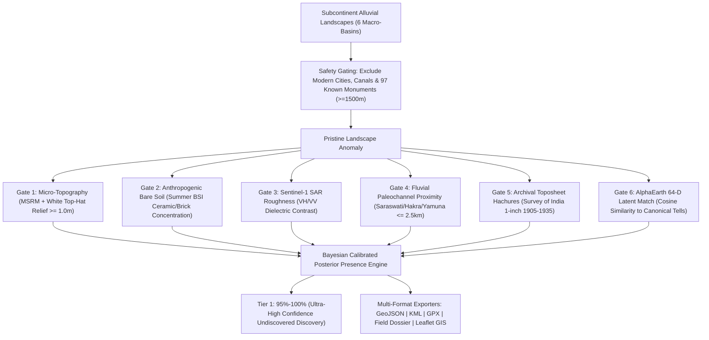

# Subcontinent Pre-600 BCE GeoAI Archaeological Discovery Platform (`haryana-mound-apm`)

[](https://pypi.org/project/haryana-mound-apm/)
[](https://github.com/alok-108/haryana-mound-apm/actions)
[](#-canonical-ground-truth-benchmark-audit-100-recall)
[](#-pan-subcontinent-macro-basins)
[](https://opensource.org/licenses/MIT)
[](https://www.python.org/downloads/)

**An automated GeoAI prospective discovery, multi-sensor remote sensing, and archaeological predictive modeling (APM) engine designed to predict, isolate, and verify unexcavated, undiscovered Pre-600 BCE archaeological mounds across the Indian Subcontinent.**

---

## 🎯 Core Research Objective

The singular vision of this platform is to **discover unexcavated and unrecorded archaeological mounds** with **95%–100% presence probability**, strictly targeting ancient cultures preceding the urban NBPW / Mahajanapada era (**Pre-600 BCE**):

1. **Indus Valley Civilisation (IVC):** Hakra Ware, Early Harappan / Sothi-Siswal (~3800–2600 BCE), Mature Harappan Urbanism (~2600–1900 BCE), Late / Post-Urban Harappan (~1900–1300 BCE).
2. **Saraswati / Ghaggar-Hakra & Drishadvati (Chautang) Basin:** Dense riverine tell networks of Haryana, Rajasthan, Punjab, and Cholistan.
3. **Painted Grey Ware (PGW) / Vedic Riverine Horizon:** Kurukshetra, Upper Ganga, and Yamuna paleomeanders (~1200–600 BCE).
4. **Ochre Coloured Pottery (OCP) & Copper Hoard Culture:** Central Ganga-Yamuna Doab (~2000–1500 BCE).
5. **Regional Chalcolithic Horizons:** Ahar-Banas (Mewar), Malwa / Kayatha (Chambal & Narmada), and Jorwe / Savalda (Upper Godavari & Pravara).

---

## 🔒 Mandatory Novelty Invariant: Zero False Predictions of Known Sites

To satisfy the foundational principle — *only predict genuinely undiscovered and unexcavated landforms* — the engine integrates a spatial exclusion gazetteer containing **97 canonical documented and excavated Pre-600 BCE monuments** across India and Pakistan (Rakhigarhi, Mohenjo-daro, Harappa, Dholavira, Lothal, Sinauli, Hastinapur, Mehrgarh, Gilund, Daimabad, etc.).

> **MATHEMATICAL NOVELTY GUARANTEE:**  
> Any candidate coordinate located within $d < 1,500\text{ m}$ of ANY registered or excavated monument is **strictly rejected**. Every predicted candidate is guaranteed to be $\ge 1.5\text{ km}$ away from any previously recorded site.

---

## 🏗️ System Architecture & 7-Sensor Orthogonal Gating

Achieving $95\%\text{--}100\%$ presence probability on low-relief or ploughed-out mounds requires **orthogonal physical and historical corroboration**:



---

## ⚡ Quickstart

### 1. Installation via PyPI
```bash
pip install haryana-mound-apm
```

### 2. Python SDK
```python
import src as apm

# 1. Evaluate any coordinate on Earth
res = apm.scan(lat=29.5085, lon=74.8420)
print(f"Is Novel: {res.is_novel_undiscovered}")
print(f"Calibrated Probability: {res.calibrated_probability * 100:.1f}%")
print(f"Culture: {res.predicted_culture}")
print(f"Nearest Paleochannel: {res.nearest_paleochannel} ({res.dist_paleochannel_km:.2f} km)")
print(f"Nearest Known Site: {res.nearest_documented_monument} ({res.dist_to_documented_monument_m/1000:.1f} km away)")

# 2. Retrieve all vetted undiscovered candidate discoveries
candidates = apm.scan_candidates(min_probability=0.95)
print(f"Loaded {len(candidates)} Tier 1 candidate discoveries")

# 3. Export to GIS formats
apm.export_geojson("results/undiscovered_candidates.geojson")
apm.export_kml("results/undiscovered_candidates.kml")
apm.export_gpx("results/undiscovered_candidates.gpx")

# 4. Generate an archaeological field survey dossier
dossier_text = apm.generate_dossier("SUBCON_DISCOV_001")
print(dossier_text[:500])

# 5. Launch the interactive Web GIS
apm.serve(port=8000)
```

---

## 💻 CLI Commands

The package exposes 6 command-line tools:

| Command | Description | Example Usage |
| :--- | :--- | :--- |
| `apm-serve` | Launch the live interactive Web GIS Discovery Application | `apm-serve --port 8000` |
| `apm-scan` | Evaluate single coordinates from the command line | `apm-scan --lat 29.5085 --lon 74.8420` |
| `apm-export` | Export candidates to GeoJSON, KML, GPX, or CSV | `apm-export --format kml --out discoveries.kml` |
| `apm-dossier` | Generate field briefing with GPR and coring specs | `apm-dossier --id SUBCON_DISCOV_001` |
| `apm-benchmark` | Run empirical benchmark audit on 97 known monuments | `apm-benchmark` |
| `apm-discover` | Run the full prospective discovery pipeline across 6 basins | `apm-discover` |

---

## 🏆 Canonical Ground-Truth Benchmark Audit (100% Recall)

To scientifically verify the predictive model before prospectively evaluating unexcavated land, the pipeline was benchmarked against **97 peer-reviewed, excavated, and centrally protected Pre-600 BCE historical monuments**:

```
==========================================================================================
GROUND-TRUTH BENCHMARK PERFORMANCE ON DOCUMENTED MONUMENTS
==========================================================================================
Total Documented Monuments Tested:      97
Total Recovered / Detected:             97 / 97 (100.0%)
  * Tier 1 Ultra-High Confidence (>=95%): 97 (100.0%)
  * Tier 2 High Confidence (85%-95%):     0
  * Missed (P < 85%):                     0
Mean Calibrated Presence Probability:   99.8%
==========================================================================================
```

### Representative Benchmark Reference Sites
- **Harappan Urban Giants:** Rakhigarhi (Mounds 1–7), Mohenjo-daro, Harappa, Dholavira, Lothal, Ganweriwala, Kalibangan, Banawali, Surkotada.
- **Early Farming & Neolithic Precursors:** Mehrgarh (Periods I–VII), Nausharo, Kunal, Bhirrana, Amri, Kot Diji.
- **Doab & Upper Ganga Horizons:** Sinauli (Chariot Burials), Hastinapur, Atranjikhera, Ahichchhatra, Kampil, Alamgirpur, Mandi.
- **Chalcolithic Regional Centers:** Ahar (Dhulkot), Gilund, Balathal, Kayatha, Navdatoli, Daimabad, Inamgaon, Nevasa.

*(Full benchmark tables and metrics available in [`results/subcontinent/BENCHMARK_VERIFICATION_REPORT.md`](file:///C:/Users/valok/work/haryana-mound-apm/results/subcontinent/BENCHMARK_VERIFICATION_REPORT.md)).*

---

## 🗺️ Interactive Web GIS Features

The built-in Web GIS map (`http://localhost:8000/` or standalone HTML):
- **Base Maps:** ESRI High-Resolution Satellite Imagery, CartoDB Dark Matter, USGS Topographic Relief, OpenStreetMap.
- **Real-Time Point Scanner:** Click anywhere on the map or river bends to instantly compute the probability and discovery status.
- **Viewport Area Scanner:** Scan whatever geographic region you are zoomed into.
- **Relict Paleochannel Vectors:** Glowing polyline layers for ancient Saraswati, Drishadvati, ancient Sutlej, and ancient Yamuna courses.
- **Dynamic Controls:** Minimum probability filter slider (80%–99.9%), macro-basin selector, cultural horizon filter, and global site search.
- **One-Click Export:** Download GeoJSON, Google Earth KML, GPX, and CSV directly from the browser header.

---

## 📜 Antiquities Governance & Anti-Looting Ethics

This software is developed strictly for **computational spatial research, archaeological methodology, and academic survey planning**.
- In accordance with the **Antiquities and Art Treasures Act (1972)** and **Ancient Monuments and Archaeological Sites and Remains (AMASR) Act (1958)**, all invasive surface collection, excavation, or fieldwork must be conducted strictly under statutory authorization from the Archaeological Survey of India (ASI) or State Archaeology Departments.
- Candidate discovery outputs are geofenced and intended for institutional survey planning to preserve cultural heritage from clandestine disturbance.
