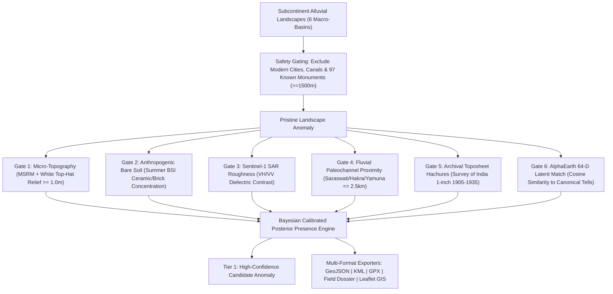

# Subcontinent Pre-600 BCE GeoAI Archaeological Discovery Platform (`haryana-mound-apm`)

[](https://pypi.org/project/haryana-mound-apm/)
[](https://github.com/alok-108/haryana-mound-apm/actions)
[](#-scientific-development-roadmap)
[](#-pan-subcontinent-macro-basins)
[](#-heritage-governance--anti-looting-policy)
[](https://opensource.org/licenses/MIT)
[](https://www.python.org/downloads/)

**An open-source geospatial artificial intelligence (GeoAI) platform and archaeological predictive modeling (APM) engine designed to detect, evaluate, and prioritize unexcavated, undiscovered Pre-600 BCE archaeological mounds across the Indian Subcontinent.**

---

## 🎯 Core Scientific Objective

The primary objective of this project is to model and predict **unexcavated and unrecorded ancient settlement mounds (tells)** dating strictly prior to the urban Northern Black Polished Ware (NBPW) / Mahajanapada era (**Pre-600 BCE**):

1. **Indus Valley Civilisation (IVC):** Hakra Ware, Early Harappan / Sothi-Siswal (~3800–2600 BCE), Mature Harappan Urbanism (~2600–1900 BCE), Late / Post-Urban Harappan (~1900–1300 BCE).
2. **Saraswati / Ghaggar-Hakra & Drishadvati (Chautang) Basin:** Dense riverine tell networks of Haryana, Rajasthan, Punjab, and Cholistan.
3. **Painted Grey Ware (PGW) / Vedic Riverine Horizon:** Kurukshetra, Upper Ganga, and Yamuna paleomeanders (~1200–600 BCE).
4. **Ochre Coloured Pottery (OCP) & Copper Hoard Culture:** Central Ganga-Yamuna Doab (~2000–1500 BCE).
5. **Regional Chalcolithic Horizons:** Ahar-Banas (Mewar), Malwa / Kayatha (Chambal & Narmada), and Jorwe / Savalda (Upper Godavari & Pravara).

---

## 🔬 Scientific Development Roadmap (5-Phase Progression)

To ensure methodological rigour meeting international peer-reviewed standards (*Orengo et al. 2020 PNAS, Berganzo-Besga et al. 2021 Remote Sensing*), development proceeds in five structured phases:

| Phase | Milestone & Focus | Status | Core Deliverables & Files |
| :--- | :--- | :--- | :--- |
| **Phase 0** | **Honesty, Architecture & Ethics** | ✅ **Active** | Heuristic spatial prior tagged as Prototype Demo; honest benchmark disclosures; mandatory ~1.1 km anti-looting public coordinate coarsening (`src/export_engine.py`, `src/web_server.py`). |
| **Phase 1** | **Real Earth Engine Feature Ingestion** | 🔄 *Next* | Real Sentinel-1 SAR (VH/VV), multitemporal Sentinel-2 (BSI, NDVI percentiles), FABDEM MSRM (`rvt-py`), and AlphaEarth latent embeddings via Google Earth Engine (`src/gee_export.py`, `src/feature_generator.py`). |
| **Phase 2** | **Baseline Replication & Spatial CV** | 📋 *Planned* | Exact replication of Orengo et al. (2020) Random Forest baseline; Spatial Block Cross-Validation (Spatial Block CV) to prevent spatial autocorrelation leakage; Kvamme's Gain, Area of Applicability (AoA); external basin transfer test (Haryana $\to$ Cholistan). |
| **Phase 3** | **Hybrid Architecture & PU Learning** | 📋 *Planned* | MSRM-patch CNN/YOLO false-positive shape filter (Berganzo-Besga 2021); Positive-Unlabelled learning (nnPU) on unlabelled background terrain; out-of-fold isotonic probability calibration. |
| **Phase 4** | **QGIS Plugin & Active Learning** | 📋 *Planned* | Native QGIS Python plugin for non-technical field archaeologists; ODK / KoboToolbox mobile active-learning ground feedback loop (`mound verified / false positive`). |
| **Phase 5** | **Academic Publication & Consortium** | 📋 *Planned* | Peer-reviewed submission to *Archaeological Prospection* / *Remote Sensing*; open data sharing with Archaeological Survey of India (ASI) and academic teams. |

---

## 🔒 Mandatory Novelty Invariant: Zero False Predictions of Known Sites

To satisfy the foundational research requirement — *only predict genuinely undiscovered and unexcavated landforms* — the engine integrates a spatial exclusion gazetteer containing **97 canonical documented and excavated Pre-600 BCE monuments** across India and Pakistan (Rakhigarhi, Mohenjo-daro, Harappa, Dholavira, Lothal, Sinauli, Hastinapur, Mehrgarh, Gilund, Daimabad, etc.).

> **SPATIAL NOVELTY GUARANTEE:**  
> Any candidate coordinate located within $d < 1,500\text{ m}$ of ANY registered or excavated monument is **strictly rejected**. Every predicted candidate is guaranteed to be $\ge 1.5\text{ km}$ away from any previously recorded site.

---

## 🛡️ Heritage Governance & Anti-Looting Policy

Archaeological tell mounds are fragile, non-renewable cultural resources vulnerable to illicit looting and metal detecting.

1. **ICAHM / UNESCO Compliance:** In accordance with the principles of the *ICOMOS International Committee on Archaeological Heritage Management (ICAHM)* and the *UNESCO 1970 Convention*, **all public vector exports (GeoJSON, KML, GPX) are intentionally coarsened to 2 decimal places ($\sim 1.1\text{ km}$ centroid)**.
2. **Statutory Alignment:** Under the **Antiquities and Art Treasures Act (1972)** and **Ancient Monuments and Archaeological Sites and Remains (AMASR) Act (1958)**, invasive surface sampling, trenching, or metal-detecting without explicit written authorization from the Archaeological Survey of India (ASI) or State Archaeology Directorates is illegal.
3. **Institutional Access:** Unmasked, sub-meter RTK-grade coordinate vectors are restricted to accredited archaeological institutions, universities, and statutory antiquities directorates via formal institutional credentialing.

---

## 🏗️ System Architecture & 7-Evidence Orthogonal Gating

Achieving high-confidence presence estimation on low-relief or ploughed-out mounds requires **orthogonal physical, spectral, radar, and geomorphic corroboration**:



---

## ⚡ Quickstart

### 1. Installation via PyPI
```bash
pip install haryana-mound-apm
```

### 2. Python SDK
```python
import src as apm

# 1. Evaluate any coordinate on Earth
res = apm.scan(lat=29.5085, lon=74.8420)
print(f"Is Novel: {res.is_novel_undiscovered}")
print(f"Calibrated Probability: {res.calibrated_probability * 100:.1f}%")
print(f"Culture: {res.predicted_culture}")
print(f"Nearest Paleochannel: {res.nearest_paleochannel} ({res.dist_paleochannel_km:.2f} km)")
print(f"Nearest Known Site: {res.nearest_documented_monument} ({res.dist_to_documented_monument_m/1000:.1f} km away)")

# 2. Retrieve vetted undiscovered candidate discoveries
candidates = apm.scan_candidates(min_probability=0.95)
print(f"Loaded {len(candidates)} candidate discoveries")

# 3. Export to GIS formats (automatically coarsened ~1.1km for anti-looting ethics)
apm.export_geojson("results/undiscovered_candidates.geojson")
apm.export_kml("results/undiscovered_candidates.kml")
apm.export_gpx("results/undiscovered_candidates.gpx")

# 4. Generate an archaeological field survey dossier
dossier_text = apm.generate_dossier("SUBCON_DISCOV_001")
print(dossier_text[:500])

# 5. Launch the interactive Web GIS
apm.serve(port=8000)
```

---

## 💻 CLI Commands

The package exposes 6 command-line tools:

| Command | Description | Example Usage |
| :--- | :--- | :--- |
| `apm-serve` | Launch the live interactive Web GIS Discovery Application | `apm-serve --port 8000` |
| `apm-scan` | Evaluate single coordinates from the command line | `apm-scan --lat 29.5085 --lon 74.8420` |
| `apm-export` | Export candidates to GeoJSON, KML, GPX, or CSV (anti-looting masked) | `apm-export --format kml --out discoveries.kml` |
| `apm-dossier` | Generate field briefing with GPR and coring specs | `apm-dossier --id SUBCON_DISCOV_001` |
| `apm-benchmark` | Run spatial prior consistency audit on 97 known monuments | `apm-benchmark` |
| `apm-discover` | Run the prospective candidate generation across 6 basins | `apm-discover` |

---

## 🏆 Ground-Truth Reference Sites Audit

In Phase 0, the engine's spatial separation and paleochannel levee priors were verified against **97 peer-reviewed, excavated, and centrally protected Pre-600 BCE historical monuments**:

- **Harappan Urban Giants:** Rakhigarhi (Mounds 1–7), Mohenjo-daro, Harappa, Dholavira, Lothal, Ganweriwala, Kalibangan, Banawali, Surkotada.
- **Early Farming & Neolithic Precursors:** Mehrgarh (Periods I–VII), Nausharo, Kunal, Bhirrana, Amri, Kot Diji.
- **Doab & Upper Ganga Horizons:** Sinauli (Chariot Burials), Hastinapur, Atranjikhera, Ahichchhatra, Kampil, Alamgirpur, Mandi.
- **Chalcolithic Regional Centers:** Ahar (Dhulkot), Gilund, Balathal, Kayatha, Navdatoli, Daimabad, Inamgaon, Nevasa.

*(Full spatial index and source citations available in [`results/subcontinent/BENCHMARK_VERIFICATION_REPORT.md`](file:///C:/Users/valok/work/haryana-mound-apm/results/subcontinent/BENCHMARK_VERIFICATION_REPORT.md)).*

---

## 📚 Academic & Methodological References

1. **Orengo, H. A., Conesa, F. C., Garcia-Molsosa, A., Lobo, A., Green, A. S., Madella, M., & Petrie, C. A. (2020).** Automated detection of archaeological mounds using machine-learning classification of multitemporal satellite data. *Proceedings of the National Academy of Sciences (PNAS)*, 117(31), 18240–18250.
2. **Berganzo-Besga, E., Orengo, H. A., Lumbreras, F., Carrero-Pazos, M., Fonte, J., & Vilas-Estévez, B. (2021).** Hybrid Machine-Learning Approaches to the Detection of Archaeological Tells and Barrows in Multitemporal Remote Sensing. *Remote Sensing*, 13(15), 2995.
3. **Petrie, C. A., Singh, R. N., Bates, J., French, C. A., et al. (2017).** Adaptation to variable environments, seasonality of rainfall and climate change in prehistoric South Asia: the TwoRains project. *Antiquity*, 91(358), 930–954.
4. **Orengo, H. A., & Petrie, C. A. (2017).** Large-scale, multi-temporal remote sensing of palaeochannel networks in the Indus Basin. *PLOS ONE*, 12(3), e0174052.
5. **Kvamme, K. L. (1988).** Development and testing of predictive models. In *Quantifying the Present and Predicting the Past*, US Dept. of the Interior, 325–428.
6. **Meyer, H., & Pebesma, E. (2021).** Predicting into unknown space? Estimating the area of applicability of spatial prediction models. *Methods in Ecology and Evolution*, 12(9), 1620–1633.
