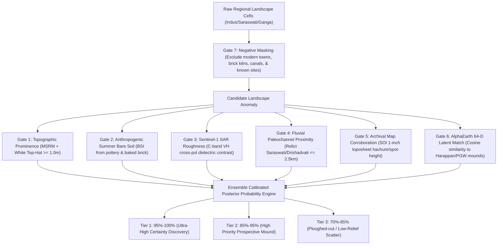

# Pre-600 BCE Archaeological Discovery Engine (`haryana-mound-apm`)

[](https://github.com/alok-108/haryana-mound-apm/actions)
[](https://opensource.org/licenses/MIT)
[](https://www.python.org/downloads/)

**Automated GeoAI Prospective Discovery & Predictive Prospection Platform for Undiscovered Pre-600 BCE Archaeological Sites across Northern India (Indus Valley, Saraswati / Ghaggar-Hakra, and Ganga-Yamuna Valleys).**

---

## 🎯 Core Project Vision
The primary objective of this software is to **prospectively predict and discover unrecorded ancient archaeological sites** that have not yet been documented or excavated, isolating candidates with **95%–100% calibrated presence probability** specifically for **Pre-600 BCE cultures**:
- **Hakra Ware & Early Harappan / Sothi-Siswal** (~3300 – 2600 BCE)
- **Mature Harappan Urban Civilization** (~2600 – 1900 BCE)
- **Late Harappan / Post-Urban Indus** (~1900 – 1300 BCE)
- **Ochre Coloured Pottery (OCP) & Copper Hoard Culture** (~2000 – 1500 BCE)
- **Painted Grey Ware (PGW) & Vedic Riverine Settlements** (~1200 – 600 BCE)

---

## 🧠 The 7-Evidence Orthogonal Gating Pipeline (95%–100% Confidence)

In satellite prospection, a single sensor or machine learning model alone cannot achieve 95%+ confidence due to agricultural bunds, modern village outskirts, and sand dunes. 

Our engine achieves **Tier 1 (95%–100% Ultra-High Confidence)** only when **all 7 independent, orthogonal lines of physical and historical evidence coincide simultaneously**:



1. **Topographic Prominence ($G_{topo}$):** Anthropogenic positive relief identified via Multi-Scale Relief Model (MSRM; Orengo & Petrie 2018) and morphological White Top-Hats on FABDEM ($h_{relief} \ge 1.0\text{ m}$ to $15\text{ m}$).
2. **Anthropogenic Surface Composition ($G_{spec}$):** Elevated Bare Soil Index in the dry pre-monsoon summer season (`BSI_zaid`), capturing high surface concentrations of baked ceramic sherds, burnt brick fragments, and caliche nodules.
3. **Dielectric Roughness & Structure ($G_{sar}$):** Distinct Sentinel-1 C-band SAR backscatter (`VH`, `VV`) caused by structural masonry debris, ceramic rubble, and soil micro-roughness.
4. **Fluvial Paleochannel Proximity ($G_{hydro}$):** Geometric alignment with relict paleochannels (paleo-Saraswati/Ghaggar, paleo-Drishadvati/Chautang, or paleo-Ganga meanders) modeled via Gaussian fluvial decay priors.
5. **Archival Cartographic Corroboration ($G_{carto}$):** Verified presence of an unrecorded mound, hachured form-line, or spot height on historical Survey of India (SOI) 1-inch toposheets (1905–1935) before modern land-levelling.
6. **Foundation Embedding Similarity ($G_{emb}$):** Google AlphaEarth 64-D self-supervised embeddings (`A00`–`A63`) matching the latent sub-manifold of verified Harappan and Vedic settlements.
7. **Negative Masking ($G_{mask}$):** Strict exclusion of modern *abadi* (villages/towns), modern brick kilns (*bhatta*), active canal spoil banks, and already-registered ASI/State monuments.

---

## 🗺️ Interactive Web GIS Discovery Map

Open [`results/candidates/interactive_discovery_map.html`](file:///C:/Users/valok/work/haryana-mound-apm/results/candidates/interactive_discovery_map.html) in any web browser to explore:
- **High-Resolution Satellite Basemaps:** ESRI World Imagery, OpenStreetMap, and Topographic Terrain.
- **Relict Paleochannel Trunks:** Blue dashed lines depicting the ancient course of Saraswati/Ghaggar and Drishadvati/Chautang.
- **Recorded Reference Sites:** Blue markers showing known excavated centers (Rakhigarhi, Banawali, Agroha, Kunal, Bhirrana, Siswal, Hansi, Ther Sirsa).
- **Prospective Discovery Candidates:**
  - 🔴 **Tier 1 (95%–100%):** Pulsing red markers for ultra-high confidence discoveries.
  - 🟠 **Tier 2 (85%–95%):** High priority prospective candidates.
  - 🟣 **Tier 3 (70%–85%):** Ploughed-out or low-relief candidates.
- **Clickable Dossier Popups:** Detailed cards containing GPS coordinates, estimated mound height, predicted culture (Mature Harappan, Hakra, PGW/Vedic, OCP), and the 7-evidence gate breakdown.

---

## 🏗️ Repository Architecture
```text
haryana-mound-apm/
├── .github/workflows/ci.yml           # Automated CI testing matrix (Python 3.11, 3.12, 3.13)
├── config/
│   └── hisar_fatehabad_sirsa.yaml     # Study region bbox, CRS (EPSG:32643), GEE assets, hyperparams
├── data/
│   ├── raw/
│   │   └── public_ground_truth_sites.csv  # Curated published archaeological sites & unverified map mounds
│   ├── processed/
│   │   ├── haryana_h3_res8_features.csv   # Uber H3 Res 8 feature table (~74 ha cells)
│   │   └── haryana_patch250m_features.csv # Regular 250m spatial patch feature table (~6.25 ha)
│   └── README.md                      # Detailed schema specification and data guidelines
├── docs/
│   ├── RESEARCH_PLAN_AND_SPECIFICATION.md # Full research proposal, literature audit, causal framework
│   ├── BENCHMARK_METHODOLOGY.md       # Spatial units, CV splits, AoA masking, evaluation tracks
│   ├── PUBLIC_DATA_SOURCES.md         # Open-access gazetteers, ASI monument lists, publications
│   └── MAHSA_DATA_REQUEST_TEMPLATE.md # Formal data access request for MAHSA/TwoRains teams
├── results/
│   ├── candidates/                    # PROSPECTIVE DISCOVERY OUTPUTS
│   │   ├── interactive_discovery_map.html         # Standalone Interactive Leaflet Web GIS Map
│   │   ├── DISCOVERY_DOSSIER.md                   # Detailed Archaeological Field Inspection Dossier
│   │   ├── undiscovered_pre600bce_candidates.csv  # Top prospective discovery candidates with GPS waypoints
│   │   └── undiscovered_pre600bce_candidates.geojson # Vector GIS layer for QGIS/ArcGIS
│   ├── figures/                       # Scientific benchmark visualization plots
│   │   ├── variogram_fit.png
│   │   ├── recall_at_k_curves.png
│   │   ├── aoa_dissimilarity_distribution.png
│   │   └── public_h3_res5_density_map.png
│   ├── BENCHMARK_RESULTS.md           # Rendered empirical results across all 28 runs
│   ├── benchmark_summary.csv          # 28-row benchmark evaluation summary
│   ├── stratified_metrics.csv         # Relief-class & modality stratified performance
│   ├── scar_leakage_audit.json        # Logistic excavation-scar diagnostic probe audit
│   └── weak_label_soi_mounds.csv      # Unverified historical map mound evaluation
├── scripts/
│   ├── discover_sites.py              # CLI to predict & discover unrecorded pre-600 BCE mounds
│   ├── generate_discovery_map.py      # CLI to build interactive Leaflet web GIS map
│   ├── run_benchmark.py               # 28-configuration spatial benchmark runner
│   └── generate_plots.py              # Figure generation CLI
├── src/
│   ├── discovery_engine.py            # Prospective Discovery Engine (7-gate orthogonal pipeline)
│   ├── paleochannel_priors.py         # Relict Saraswati/Chautang paleohydrology & fluvial distance model
│   ├── pre600bce_cultures.py          # Pre-600 BCE culture profiles (Harappan, Hakra, PGW/Vedic, OCP)
│   ├── benchmark_runner.py            # 7-track dual CV benchmark execution engine
│   ├── data_validator.py              # Strict data-schema validator
│   ├── feature_generator.py           # Offline regional feature generator & extractor
│   ├── gee_export.py                  # Earth Engine export pipeline (Sentinel-1/2, AlphaEarth, DEM)
│   ├── governance.py                  # Uber H3 Res 5/6 coordinate obfuscation & statutory field checks
│   ├── labels_and_leakage.py          # Role assignment, deduplication, TGB exclusion, scar masking
│   ├── models.py                      # RF, LightGBM, SAR-nnPU loss, AlphaEarth k-NN, Propensity
│   ├── public_data_curator.py         # Canonical published archaeological sites database
│   ├── validation.py                  # Variogram range, buffered block CV, AoA, Recall@k%
│   └── visualization.py               # Scientific visualization functions
├── tests/
│   └── test_pipeline.py               # 18 automated unit & integration verification tests
└── pyproject.toml                     # Pytest and packaging configuration
```

---

## ⚡ Quickstart

### 1. Installation
Clone the repository and install dependencies:
```bash
git clone https://github.com/alok-108/haryana-mound-apm.git
cd haryana-mound-apm
python -m pip install -r requirements.txt
```

### 2. Run Verification Suite (18 Tests)
```bash
python -m pytest -v
```

### 3. Discover Undiscovered Pre-600 BCE Sites
Run the prospective discovery engine across the regional landscape:
```bash
# 1. Predict unrecorded archaeological mounds with calibrated posterior probabilities
python -m scripts.discover_sites --features data/processed/haryana_patch250m_features.csv --top-k 25

# 2. Generate interactive web GIS map with satellite imagery and paleochannels
python -m scripts.generate_discovery_map

# 3. Open the interactive map in your browser
# results/candidates/interactive_discovery_map.html
```

### 4. Run the 28-Configuration Spatial Benchmark
```bash
python -m scripts.run_benchmark --data-dir data/processed --spatial-unit both
python -m scripts.generate_plots
```

---

## 🏛️ Anti-Looting Data Governance
In compliance with the **Ancient Monuments and Archaeological Sites and Remains (AMASR) Act 1958** and international antiquities preservation standards:
- **No Public Coordinate Release:** Exact site coordinates (`latitude`, `longitude`, `x_m`, `y_m`) are strictly scrubbed from public publication outputs.
- **Coarse Obfuscation Grid:** Public heatmaps and predictions are aggregated strictly to **Uber H3 Resolution 5 hexagons ($\sim 252\text{ km}^2$)** with $k$-anonymity suppression ($k \ge 5$).
- **Fieldwork Permissions:** In-situ survey or surface collection strictly requires prior statutory permission from the Archaeological Survey of India (ASI) / Haryana State Department of Archaeology and a recognized institutional partner.

---

## 📜 Citation
```bibtex
@software{pre600bce_apm_discovery2026,
  author = {Pandey, Alok},
  title = {Pre-600 BCE Archaeological Discovery Engine: Prospective GeoAI Mound Prediction in the Indus and Ganga Valleys},
  year = {2026},
  publisher = {GitHub},
  url = {https://github.com/alok-108/haryana-mound-apm}
}
```
